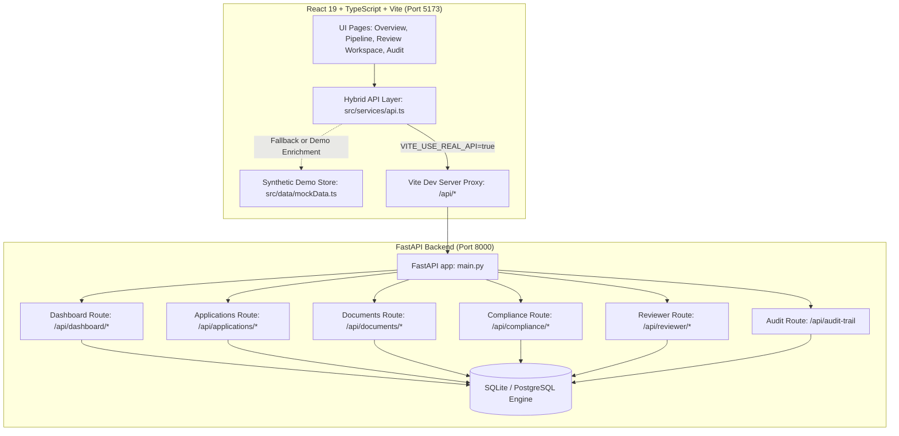

# AICTE VerifyAI — Full-Stack Integration Guide
**Version:** 1.0.0 (SIH26261)  
**Components:** FastAPI Backend (`backend/`) + React 19 / Vite Frontend (`frontend/`)

---

## 1. Executive Summary

This document describes the end-to-end integration architecture bridging the **FastAPI backend** (document processing, compliance engine, anomaly detection, mock issuer verification, reviewer workflow, audit trail) with the **React 19 + TypeScript + Vite frontend** for the Smart India Hackathon project **AICTE VerifyAI (SIH26261)**.

### Integration Principles:
1. **Hybrid Bridge Layer:** The frontend features an intelligent adapter service ([`frontend/src/services/api.ts`](file:///c:/Users/Namith%20Singh/OneDrive/Documents/SIH3RDATTEMPT/frontend/src/services/api.ts)) that connects to live backend endpoints while preserving rich demo-tier client enrichments (synthetic OCR documents, cross-document comparison tables, reviewer timeline annotations).
2. **Zero-Configuration Local Development:** A Vite development proxy (`/api` -> `http://localhost:8000`) and comprehensive FastAPI CORS middleware work in tandem, allowing both direct cross-origin calls and proxied same-origin calls.
3. **Graceful Fallbacks:** If the backend is temporarily offline or encounters an unhandled state, the frontend automatically falls back to synthetic demonstration datasets without crashing.
4. **Advisory Decision Support:** Adheres strictly to the AICTE regulatory guideline that automated findings provide officer decision support and never execute automated rejections.

---

## 2. Architecture & Data Flow



---

## 3. Configuration & Environment Variables

### Frontend Configuration (`frontend/.env`)
Copy `frontend/.env.example` to `frontend/.env`:
```env
# Backend API base URL
# When running locally with Vite proxy, you can set this to '/api' or 'http://localhost:8000/api'
VITE_API_BASE_URL=http://localhost:8000/api

# Set to "true" to connect to the live FastAPI backend.
# Set to "false" to use embedded synthetic mock data for standalone demonstration.
VITE_USE_REAL_API=true
```

### Backend CORS Configuration (`backend/app/config.py`)
Configured to allow the following default local dev origins:
- `http://localhost:5173` (Vite dev server)
- `http://127.0.0.1:5173`
- `http://localhost:3000`
- `http://127.0.0.1:3000`

---

## 4. Endpoints Mapping Table

| Frontend View / Action | Backend Endpoint | Method | Integration Status | Fallback / Enrichment Behavior |
|---|---|---|---|---|
| **Health Check** | `/api/health` | `GET` | **Live** | Returns backend status, version, and environment. |
| **Overview Metrics** | `/api/dashboard/stats` | `GET` | **Live** | Maps total applications, review queue counts, finding severities. |
| **Audit Events Log** | `/api/audit-trail?page=1&page_size=N` | `GET` | **Live** | Retrieves chronologically ordered system and reviewer audit events. |
| **Pipeline / Applications List** | `/api/dashboard/stats` + `/api/applications` | `GET` | **Hybrid** | Connects to backend for application counts and statuses; enriches with synthetic case studies for demo. |
| **Review Workspace Findings** | `/api/reviewer/applications/{id}/combined-findings` | `GET` | **Live/Hybrid** | Merges validation checks, mock issuer verification results, and compliance rule evaluations. |
| **Approve Decision** | `/api/applications/{id}/review` | `POST` | **Hybrid** | Posts reviewer action to backend (`new_status="reviewed"`), records immutable audit entry, updates client state. |
| **Reject Decision** | `/api/applications/{id}/review` | `POST` | **Hybrid** | Posts reviewer note and observation to backend, updates client state. |
| **Escalate Decision** | `/api/applications/{id}/review` | `POST` | **Hybrid** | Posts `new_status="escalated"` with committee referral note to backend. |
| **Request Evidence** | `/api/applications/{id}/review` | `POST` | **Hybrid** | Posts `new_status="needs_information"` with documentary deficiency note to backend. |
| **Reviewer Profile** | Client-side store | N/A | **Synthetic** | Mock officer profile (`Priya Venkataraman, Senior Compliance Reviewer`). |

---

## 5. How to Run Frontend and Backend Together

### Terminal 1: FastAPI Backend
```bash
cd backend
# Activate virtual environment if configured:
# .\venv\Scripts\activate (Windows) or source venv/bin/activate (Linux/Mac)
python -m pytest               # Verify all 132 automated tests pass
python -m uvicorn app.main:app --reload --port 8000
```
- Interactive Swagger UI: `http://localhost:8000/docs`
- Health check: `http://localhost:8000/api/health`

### Terminal 2: React Frontend
```bash
cd frontend
npm install                    # Install dependencies (React 19, Lucide, Tailwind, Vite)
npm run build                  # TypeScript check and production bundle build
npm run dev                    # Start Vite development server
```
- Open browser at: `http://localhost:5173`

---

## 6. Verification & Quality Assurance

- **Backend Unit & Integration Tests:** 132 tests passing (`pytest-8.4.2`, `Python 3.13.7`).
  - `tests/test_health.py` (3 passed)
  - `tests/test_applications.py` (13 passed)
  - `tests/test_documents.py` (20 passed)
  - `tests/test_classifier_and_fields.py` (14 passed)
  - `tests/test_validation.py` (16 passed)
  - `tests/test_anomaly.py` (19 passed)
  - `tests/test_issuer_verification.py` (11 passed)
  - `tests/test_compliance.py` (12 passed)
  - `tests/test_dashboard.py` (4 passed)
  - `tests/test_phase6_audit.py` (6 passed)
  - `tests/test_phase6_cors.py` (3 passed)
  - `tests/test_phase6_dashboard.py` (4 passed)
  - `tests/test_phase6_reviewer.py` (6 passed)
  - `tests/test_phase6_schema_compatibility.py` (1 passed)
- **Frontend Type Safety & Bundling:**
  - `tsc -b`: 0 errors.
  - `vite build`: Successfully builds 2,164 modules into `dist/`.
  - `oxlint`: 0 errors.
